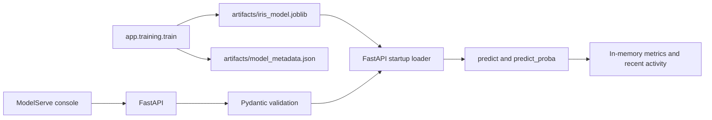

# ServeML

**ServeML** is a compact ML inference project with a developer console called **ModelServe**. It trains a real scikit-learn Iris classifier, packages the fitted pipeline as a joblib artifact, and serves real single and batch predictions through FastAPI.

The project demonstrates the full path from a reproducible training run to a loaded model, validated HTTP requests, observed runtime metrics, and a browser-based inference playground.

## Model

- **Model:** `RandomForestClassifier` in a scikit-learn `Pipeline`
- **Dataset:** scikit-learn's bundled Iris dataset
- **Evaluation:** stratified 80/20 holdout; 120 training rows and 30 test rows
- **Holdout accuracy:** 96.67%
- **Trees:** 160
- **Inputs:** four Iris measurements in centimeters
- **Classes:** setosa, versicolor, virginica
- **Verified runtime:** Python 3.13.14, scikit-learn 1.9.1, NumPy 2.5.3, SciPy 1.18.1

The tracked files in `artifacts/` are the actual trained model and metadata produced by the training pipeline. The model file is 35,929 bytes. Including these files lets a fresh clone start the API without training first.

## Architecture



The browser UI is static HTML, CSS, and JavaScript served by FastAPI. It reads model details and runtime telemetry from the API and sends inference requests to the loaded artifact. No separate frontend server or build step is required.

## Features

- Single and batch Iris inference using the serialized RandomForest pipeline
- Predicted class, class probabilities, model version, and measured latency
- Strict input validation and structured errors
- Model metadata and `/health` readiness endpoint
- Process-local request counts, success rate, average latency, class distribution, uptime, and the latest 12 predictions
- Light-theme developer console with an inference playground, model details, metrics, and API reference
- Generated OpenAPI schema at `/openapi.json`

Metrics and recent prediction activity live in memory and reset when the API process restarts. They are runtime counts, not persistent monitoring or historical time series.

## API

| Method | Endpoint | Purpose |
|---|---|---|
| `GET` | `/health` | Model and service readiness (`200` ready, `503` unavailable) |
| `GET` | `/api/v1/model` | Model name, version, and status |
| `GET` | `/api/v1/model/metadata` | Training, evaluation, class, and artifact metadata |
| `POST` | `/api/v1/predict` | One prediction with class probabilities |
| `POST` | `/api/v1/predict/batch` | Predictions for 1–250 observations |
| `GET` | `/api/v1/metrics` | Process-local inference metrics and recent activity |

Interactive API documentation is available at `/docs`; the OpenAPI contract is generated from the FastAPI routes and schemas.

Example request:

```json
{
  "sepal_length": 5.1,
  "sepal_width": 3.5,
  "petal_length": 1.4,
  "petal_width": 0.2
}
```

Measurements must be finite numbers greater than 0 and at most 10. Batch requests use `{"instances": [<measurement>, ...]}` and may contain at most 250 rows. Invalid requests return `422`; inference failures return `503` without exposing internal exception details.

## Setup

Python 3.12 or newer is required by the pinned NumPy and SciPy versions. Python 3.13.14 is the verified runtime.

### Windows PowerShell

```powershell
py -3.13 -m venv .venv
.\.venv\Scripts\Activate.ps1
python -m pip install -r requirements.txt
```

### macOS or Linux

```bash
python3 -m venv .venv
source .venv/bin/activate
python -m pip install -r requirements.txt
```

The checked-in model artifact is ready to load after installation. To regenerate the model and metadata from the reproducible Iris training pipeline:

```bash
python -m app.training.train
```

Start the API and browser console together:

```bash
python -m uvicorn app.main:app --reload
```

Open <http://127.0.0.1:8000>. API docs are at <http://127.0.0.1:8000/docs>.

## Tests and checks

```bash
pytest -q
node --check app/static/app.js
```

The test suite covers artifact reload and inference, health, metadata, single and batch predictions, validation, and runtime metrics. There is no standalone frontend bundler; FastAPI serves the source assets directly.

## Project structure

```text
app/
  api/             FastAPI routes
  core/            Environment-based settings
  schemas/         Validated request and response models
  services/        Model runtime and process-local metrics
  static/          ModelServe HTML, CSS, and JavaScript
  training/        Reproducible Iris training pipeline
artifacts/         Trained joblib model and generated metadata
tests/             API and serialized-model tests
.env.example       Optional non-secret configuration defaults
requirements.txt   Pinned, verified Python dependencies
```

## Technical decisions

- Keep the frontend as static assets served by FastAPI; a framework or frontend build system would add complexity without helping this small console.
- Keep observability process-local and label its lifetime clearly instead of implying durable monitoring or invented history.
- Commit the small, verified model artifact and metadata so the cloned project runs immediately; the training command reproduces both.
- Pin the verified ML and application dependencies to make artifact loading and test results reproducible.

## Limitations and security

- This is a local development demonstration. It has no authentication and should not be exposed to an untrusted network without adding an appropriate security boundary.
- Metrics and prediction history are in-memory only and reset on process restart.
- Joblib artifacts use Python pickle serialization. Load only trusted artifacts.
- Starlette currently emits a deprecation warning for its `httpx`-based `TestClient`; the suite passes, and this dependency warning does not affect runtime inference.

## License

MIT. See [LICENSE](LICENSE).

## Future work

Durable telemetry, authentication, artifact signing and promotion, and automated CI are possible future improvements; they are not implemented by this project.
